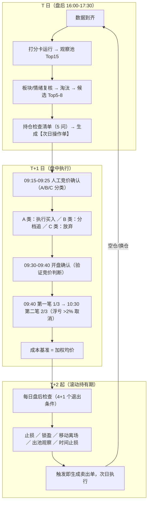

# 短线打板 · 涨停基因策略（T+1 竞价人工确认）—— 新策略研究方向 v0.1

> - **定位**：新策略研究方向之一。A 股短线右侧——T 日盘后打分选"有涨停基因、技术面蓄势"的票，T+1 竞价人工确认后分批买入，滚动持有至止盈/止损/信号失效任一触发。
> - **来源**：2026-11-21 的 8 张原型图（〇 ～ 十四 + 附录）逐条整理。正文内容与原文一致，仅做两处规范化（见「整理说明」）。
> - **状态**：设计稿，**未回测、未代码化**。原文自定的启动路径 = 纸面跟踪 2 周 → 首周只做 A 类 3 只 → 再放大。
> - **与现有体系的关系**：与主池三策略（7.1 高波动动量 / 跨市场避险 / ETF 底部）及卫星（恐慌抄底 / 微盘 / 妖债）**不共享逻辑**——它是 T+1 竞价定生死的短线打板，与 7.1 的日线轮动不是同一时间尺度（重叠风险见 §15.1）。

## 整理说明（相对原图的处理）

| 处理 | 原因 |
|:---|:---|
| **跨章引用编号校正**：原文"按第六部分分批买入"→"第五部分"；"（见第五部分）"→"第四部分" | 原文章号与正文引用整体错位 1 位（原文写作时的编号应为"五=竞价确认、六=分批买入"，成稿后章号前移）。按本文档实际章号改写，避免读者跳错章 |
| 表格化 | 原图为 Word 表格，按 Markdown 表格重排，**未改任何数值** |
| 新增 §15「研究视角」 | 作为"研究方向"登记所需：标出待验证假设与数据缺口。**明确标注为整理者补充，非原文内容** |
| **数据现状对齐（2026-11-22）** | §1.4 新增两段式职责分层；§3.1 补系统落库位置；§15.3 缺口按实测改写（涨停价/涨停统计已补齐，竞价+分钟定案人工同花顺核对）。**只改"数据可得性"表述，未动策略规则与数值** |

---

## 〇、核心原则（每次操作前默念）

1. **盘中只执行，不决策**——所有决策前置到 T 日盘后 / 竞价时点，用规则代替临场判断
2. **止损无条件优先**——任何信号冲突时，止损 > 信号 > 情绪
3. **每条路径都有出口**——不存在"再等等看"的状态；观察必有上限，持有必有时止损
4. **参数是起点不是终点**——靠交易记录每周校准，不靠感觉

---

## 一、策略定义与约束声明

### 1.1 策略一句话

> 用 T 日收盘数据打分选出"有涨停基因、技术面蓄势"的票，T+1 日经人工竞价确认后分批买入，滚动持有至止盈/止损/信号失效中任一条触发。

### 1.2 固定约束（不可突破）

| 约束项 | 内容 | 影响 |
|:---|:---|:---|
| 本金 | 20 万（40/30/30 架构中量化份） | 单票 ≤20%（4 万） |
| 交易制度 | A 股 T+1：当日买入次日才能卖 | **买入当日无法止损** |
| 数据时点 | T 日 16:00-17:30 才拿到当日完整数据 | 信号滞后半天 |
| 竞价数据 | 前期无量价竞价数据 → 人工盯盘确认（同花顺手机版） | 竞价判断靠人工执行 |
| 交易成本 | 佣金万 2.5×2 + 印花税万 5 ≈ 0.15%/完整往返 | **换手率必须受限** |
| 涨跌停 | 主板 ±10% / 创业板科创 ±20% | 一字板买不进、跌停卖不出 |

### 1.3 收益来源与边界（诚实的预期）

| 项 | 数值 | 说明 |
|:---|:---|:---|
| 收益来源 | 涨停基因/动量延续 + 板块共振 | 少数大牛贡献主要利润（右尾） |
| 单票胜率预期 | 40-55%（经验估计） | 靠盈亏比取胜，不靠胜率 |
| 目标盈亏比 | ≥2:1（+10% 锁盈 vs -6% 止损） | 结构性保证 |
| 本策略不做 | 不预测大盘、不摸日内顶底、不抄底 | 只做"信号 → 确认 → 执行" |

### 1.4 两段式职责分层（数据现状对齐版，2026-11-22）

> 系统已补齐日线级涨停/涨跌停价数据（`stock_limit_list` 2020-01 起、`stock_daily_limit` 2020-01 起），但**竞价与分钟数据系统无表/无接口**（`stock_minutes` 空表）。因此把策略拆成「**选股用系统数据 → 买卖由人工核对竞价/分钟**」两段，明确每段由谁出、能不能回测。

| 层 | 阶段 | 用到的数据 | 谁出 | 可回测？ |
|:---|:---|:---|:---|:---|
| **A 选股层** | T 日盘后打分 → 观察池 Top15 → 候选 Top5 | 涨停基因（`stock_limit_list`）、量比/换手/市值（`stock_daily_basic`）、均线/乖离（`stock_daily`）、板块涨停家数（`stock_limit_list`+申万）、情绪 4 温度数（`market_router.do_limit_ladder`） | **系统** | ✅ 日线，全可回测 |
| **B 买入层** | T+1 竞价 A/B/C 分类 → 开盘 10 分钟确认 → 分批买入 | 竞价量价、分时均线、分时量比 | **人工**（同花顺核对） | ❌ 不可回测，靠规则 + 纸面跟踪 |
| **C 持有层** | T+2 起每日盘后检查退出条件 | 日线级：收盘价、ATR、MA10、打分排名 | **系统** | ✅ 可回测 |
| **C' 持有盘中** | 炸板减半、首跌停出、跳水放弃（§6.4） | 盘中分时、炸板状态 | **人工**（同花顺核对） | ❌ 靠规则 + 人工执行 |

> **一句话**：系统管「选谁」和「日线级何时走」，人工管「今天买不买、怎么买、盘中怎么应对」——**人工环节不是"看感觉"，而是照 §四/§五/§6.4 的规则表执行**（规则已写死，只是执行载体是人）。

---

## 二、总体闭环流程图（先看全貌）



---

## 三、数据与打分卡（T 日盘后 16:00-17:30）

### 3.1 输入数据（A 选股层 = 系统日线数据，已落库可回测）

| 数据 | 系统落库位置 | 用途 |
|:---|:---|:---|
| 当日涨幅/成交量 | `stock_daily` | 量能维度 |
| 量比/换手率/市值 | `stock_daily_basic`（`volume_ratio`/`turnover_rate` 等字段） | 量能维度 |
| 近期涨停记录（60 日内） | `stock_limit_list`（limit_type=U 涨停） | 涨停基因 |
| 均线值（5/10/20/60）及乖离 | `stock_daily` 计算 | 形态/成本 |
| 板块涨停家数、板块指数走势 | `stock_limit_list` + 申万 `index_sw_*` | 板块共振 |
| 昨日涨停今日溢价、全天涨停家数、炸板数、最高连板 | `market_router.do_limit_ladder` 已算（4 温度数） | 情绪周期 |

> 以上为 **A 选股层**数据，全部日线级、系统已具备，打分卡可完整回测。**B 买入层 / C' 持有盘中**的竞价量价、分时均线、分时量比系统无表（§15.3），由人工在同花顺核对执行。

### 3.2 打分卡（10 分制，与前版一致）

| # | 维度 | 打分标准 | 分值 |
|:--:|:---|:---|:--:|
| 1 | 涨停基因 | 近 60 日有涨停记录 | +2 |
| 2 | 形态 | 横盘 ≥20 日 **或** 缩量回调到位 | +1.5 |
| 3 | 均线 | 5/10/20 粘合 **或** 刚发散 | +1.5 |
| 4 | 量能 | 量比 1.5-3 **+** 换手 3~10% | +1.5 |
| 5 | — | 递进放量 ≥2 日 | +1 |
| 6 | — | 缩量洗盘后首次放量 | +1 |
| 7 | 板块 | 所属板块当日有 ≥2 只涨停 | +1 |
| 8 | 情绪 | 涨停家数 >50 **且** 炸板率 <40% | +0.5 |
| | | **总分** | **10 分** |

> **入选规则**：候选需 ≥6 分。情绪冰点（4 个温度数恶化）时，门槛升至 7 分。

### 3.3 观察池管理

| 规则 | 值 |
|:---|:---|
| 总分排序 | Top15 进观察池 |
| 实买数量 | Top5，同板块 ≤2 只 |
| 候选生成 | 观察池剔除"一字板/停牌/成交量<3000 万"后取前 5 |
| 门槛 | <6 分 不进池；情绪冰点时 <7 分 不进池 |

> ⚠️ **系统性偏差防范**：打分卡选的是"今天最强"，若过滤规则把"明天最强（= 高开最多）"排除，就会买到次优。因此竞价确认环节**不设"一刀切 >7% 就放弃"**，而是分为 A/B/C 类分别处理（见第四部分）。

---

## 四、T+1 竞价人工确认流程（人工盯盘，核心环节）

> 前期无量价竞价数据，全部由人工在同花顺手机版执行。这是买入前的**最后一道质量门**——打分卡决定"候选谁"，竞价决定"今天买不买、怎么买"。

### 4.1 时间流程

| # | 时间 | 动作 |
|:--:|:---|:---|
| 1 | 09:15 | 同花顺打开观察池（Top5 候选股页面逐个置顶） |
| 2 | 09:15-09:20 | 逐个查看竞价情况 → 按 A/B/C 分类（判断标准见下） |
| 3 | 09:25 | 竞价结束，记录最终竞价结果（高低开幅度/竞价量） |
| 4 | 09:25-09:30 | 确定当日操作方案（照 4.2 分类表执行） |
| 5 | 09:30-09:40 | 开盘确认（4.3）：验证竞价判断，决定第一笔是否如期 |

### 4.2 竞价分类判断标准（照单执行，不含糊）

| 类型 | 竞价特征 | 决策 | 动作 |
|:---|:---|:---|:---|
| **A 类**（标准买点） | 高开 **0~5%** 且竞价量能温和放大（<昨日全天量 20%） | 执行买入 | 按第五部分分批买入 |
| **B 类**（强势追） | 高开 **5~9%** 且竞价量能显著放大 + 板块当日强势（板块 ≥2 只涨停） | 执行分档追 | 1/4 + 1/4 + 1/2 三笔（接受追高成本） |
| **C 类-放弃** | 一字涨停（≥9.9% 就一字）、秒板 | 放弃 | 不排队、不追（买不进 = 踏空，不是失败） |
| **C 类-放弃** | 低开 或 平开缩量（信号失效） | 放弃 | 该候选当日移除，不留恋 |
| **C 类-延后** | 高开 0~5% 但竞价量能异常（>昨日全天 50%） | 延后 | 首笔取消，开盘 30 分钟后再评估（防竞价对倒诱多） |

> **判断口诀**：竞价合格（A/B）→ 照计划执行；竞价不及预期（C）→ 立即放弃，每次放弃省一次止损。

### 4.3 开盘 10 分钟确认（09:30-09:40）

> 规则：第一笔买入前，先看 09:30-09:40 分时走势确认竞价判断。

| 观察项 | 确认标准 | 动作 |
|:---|:---|:---|
| 分时站稳 | 开盘后股价守住竞价价格上方 **+** 分时均线不破 | 按计划下第一笔 |
| 快速走弱 | 破分时均线 **且** 跌破竞价价格 -1% | A 类降级为放弃；B 类只下第一笔 1/4 |
| 放量拉升 | 10 分钟内涨幅 >5% **且** 量能阶梯放大 | 提前按计划买入（不追高过竞价价格 +5%） |
| 突然跳水 | 竞价高开后直杀翻绿 | 全部放弃（主力出货信号） |

---

## 五、分批买入执行（T+1 09:40-10:30）

### 5.1 建仓节奏

| 类型 | 第一笔 | 第二笔 | 第三笔 | 成本基准 |
|:---|:---|:---|:---|:---|
| **A 类**（0-5%） | 09:40 买入 1/3 | 10:30 买入 2/3 | — | 两笔加权均价 |
| **B 类**（5-9%） | 09:40 买入 1/4 | 10:30 买入 1/4 | 14:00 买入 1/2 | 三笔加权均价 |

### 5.2 第二笔/第三笔的触发条件（硬规则）

**第二笔（A 类 2/3）触发条件：**

- [ ] 第一笔成交后 30 分钟内浮亏 ≤ -2%（浮亏超限 → 取消第二笔，**禁止摊平**）
- [ ] 个股未触发跌停（触发 → 取消）
- [ ] 板块未见批量跌停（见 → 取消）

**第三笔（B 类 1/2）触发条件：**

- [ ] 前两笔累计浮亏 ≤ -2%
- [ ] 分时站稳 MA10
- [ ] 板块涨停数未减少

> ⚠️ **禁止摊平原则**：第一笔买完就快速下跌 → 永远只取消后续笔数，**绝不加仓摊平**。这是分批买入唯一的纪律价值。

### 5.3 买入总仓位控制

1. 单票单日最大投入 = **4 万（20%）**
2. 单日最多新买入标的 = **2 只**（与持仓规模、调仓节奏一致）
3. 买入当日总仓位增量 ≤ **40%**（其余仓位等 T+2 后滚动确认）

---

## 六、持有状态机（T+2 起，滚动持有）

> 这是"选股逻辑与持有逻辑"的桥接：打分卡管"买什么"，状态机管"什么时候走"。

### 6.1 持仓状态定义

```
持有（正常） → 出池观察（预警） → 减仓（半仓） → 清仓（离场）
```

> 任何状态转换由【确定性条件】触发，无模糊地带。

### 6.2 退出条件（4+1，任一触发即动作，每日盘后检查）

| # | 条件 | 判定 | 动作 | 优先级 |
|:--:|:---|:---|:---|:---|
| 1 | **硬止损** | 收盘价 < 成本加权均价 -6%（或 1.5×ATR） | 次日开盘清仓 | 最高 |
| 2 | **锁盈** | 浮盈 +10% / +20% | +10% 减 1/3，+20% 再减 1/3 | 高 |
| 3 | **移动离场** | 剩余 1/3 仓位：最高价回撤 -12% 或 收盘破 MA10 | 清剩余 | 高 |
| 4 | **出池确认** | 跌破打分阈值 Top50 连续 2 日 **且**（破 MA10 或 低于成本） | 减半/清仓 | 中 |
| 5 | **时间止损** | 持有满 8 交易日未达 +6% | 次日离场 | 中 |

### 6.3 出池钝化规则（防洗盘误杀）

1. **出池 ≠ 卖出，出池 = 进入观察**
2. **触发观察**：打分跌出 Top50（连续 1 日即进入观察名单）
3. **确认条件**（满足其一才清仓）：
   - a) 观察 **且** 收盘跌破 MA10 → 清仓
   - b) 观察 **且** 收盘价低于买入均价 → 清仓
   - c) 观察满 2 个交易日未恢复 → 减半保留，再观察
4. **恢复条件**：重回 Top50 → 回到正常持有

> 出池逻辑保留"信号失效就走"的智慧，但用**连续 2 日 + 价格确认**钝化，避免洗盘日一天的波动就被打脸卖出。

### 6.4 涨停持仓特殊规则

| 情形 | 动作 |
|:---|:---|
| 缩量一字板 | 不动（最强形态，让利润奔跑） |
| 放量炸板（打开 ≥30 分钟未回封） | 当日收盘前减 1/2；次日不反包（不涨停且未创新高）清仓 |
| 持仓首现跌停 | 次日开盘出（不博反包） |
| 所属板块当日批量跌停 | 非跌停持仓同步减半 |

---

## 七、止盈止损体系（退出层全表）

### 7.1 止损（左侧，无条件优先）

| 规则 | 参数 | 备注 |
|:---|:---|:---|
| 硬止损 | 成本加权均价 **-6%** | 不用 -4%（强势股日振幅 8-15%，-4% 在噪音带内会被洗盘反复扫出） |
| 波动自适应 | `min(-6%, -1.5×ATR(14))` | 高波动票给更宽止损，防打穿 |
| 止损命令 | 触发次日开盘价卖出 | 盘中浮亏触及但未收低？以**收盘判定**为准（避免日内噪音触发）；连续 2 日破位则不等收盘 |

### 7.2 跌停预案（止损线救不了的情况）

1. **一字跌停**：次日 9:15:00 挂跌停价卖出（集合竞价时间优先，早挂早排队）
2. **开盘瞬间**：不等待，至少出半仓（开盘 ≠ 当天唯一流动性窗口）
3. **板块批量跌停**：非跌停持仓同步减半（等自己跌停就晚了）

### 7.3 止盈（右侧，保留右尾 + 防深度回吐）

| 阶段 | 触发 | 动作 |
|:---|:---|:---|
| 第一档 | 浮盈 +10% | 减 1/3 |
| 第二档 | 浮盈 +20% | 再减 1/3（累计锁 2/3） |
| 趋势仓 | 剩余 1/3：最高价回撤 -12% 或 收盘破 MA10（先到先走） | 清仓 |

> 为什么「不主动止盈」：A 股退潮期通常连续跌停，"最高点 -8%" 在炸板常态下会被洗出，且利润大幅回吐心态崩溃。+10%/+20% 减仓 + 剩余 -12% 移动 = 让利润奔跑 + 锁住大部分利润的最优折中。

---

## 八、系统级风控（20 万本金护栏）

| 规则 | 参数 | 说明 |
|:---|:---|:---|
| 单票仓位 | ≤4 万（20%），同板块 ≤2 只 | 流动性风险第一道防线 |
| 情绪退潮降仓 | 连板 ≤3 板 或 炸板率 >40% → 总仓 ≤50% | 用情绪温度计控进仓位 |
| 单日回撤 | 当日 -3% → 次日减半仓，复盘 | 及时止血 |
| **累计回撤熔断** | 总资产 **-8%**（≈1.6 万）→ **强制空仓 3 个交易日**，复盘后重启 | 防"连亏后加倍翻本" |
| 买入日失效窗口 | 买入当日不可卖 → 若买入即触发 -6%，承认亏损，次日按预案处理 | 用单票 20% 仓位兜住 |

**损益自检（20 万实账）**：

- 单票 -6% 止损 = 4 万 × 6% = **2400 元 ≈ 总资产 -1.2%** ✓
- 最坏同日 3 只触发 ≈ **-3.6%**，在单日阈值内 ✓
- 一字三连跌停单票 ≈ **-5.4%** 总资产，靠情绪降仓在事前概率低 ✓

---

## 九、每日执行 SOP（闭环操作单）

### 9.1 T 日盘后（16:00-17:30，规则化流程）

| # | 步骤 | 内容 |
|:--:|:---|:---|
| 1 | STEP1 数据收集 | 行情 / 涨停明细 / 板块 / 情绪温度计 4 个数 |
| 2 | STEP2 打分卡 | 全市场或自选池打分 → 观察池 Top15 |
| 3 | STEP3 复盘 | 情绪冰点？→ 门槛升至 7 分 / 降仓 |
| 4 | STEP4 持仓检查清单（5 问） | ① 破止损线？（成本 -6%/1.5ATR）<br>② 触及锁盈？（+10%/+20%）<br>③ 出池确认？（Top50 外 2 日 + 破 MA10/低于成本）<br>④ 炸板未反包？/ 首跌停？<br>⑤ 板块退潮？→ 整体降仓 |
| 5 | STEP5 生成【次日操作单】 | 见下方模板 |

**次日操作单（日期：____）**

- 卖出（无条件）：代码 / 名称 / 原因
- 卖出（条件性）：触发条件 / 命令
- 买入候选：A 类 / B 类 / C 类标记
- 放弃名单：理由
- 仓位：当前 __% → 目标 __%

### 9.2 T+1 盘中（照单执行，不新增决策）

| 时间 | 动作 |
|:---|:---|
| 09:15-09:25 | 竞价确认（第四部分分类表） |
| 09:30-09:40 | 开盘确认 |
| 09:40-10:30 | 分批买入（第五部分） |
| 10:30-11:30 | 二笔完成，不动（除非触发跌停/板块雪崩） |
| 13:00-14:00 | 若持仓异动（炸板/跳水/拉升）→ 按第六部分规则动作 |
| 14:30 | 尾盘：若 B 类第三笔未触发条件，记录待办 |
| 15:00 | 收盘：记录成交 / 持仓状态 |

### 9.3 每笔交易记录模板（参数校准的数据源）

| 日期 | 代码 | 方向(买/卖) | 价格 | 数量 | 触发规则(写死) | 持仓成本 | 备注(禁止写"感觉") |
|:---|:---|:---|:---|:---|:---|:---|:---|
|  |  |  |  |  |  |  |  |

---

## 十、参数校准回路（每周六 30 分钟）

| 指标 | 统计口径 | 调参规则 |
|:---|:---|:---|
| 止损反弹率 | 止损后 5 日内反弹回止损价的比例 | >50% → 止损过紧，-6% 放宽至 -7%/-8% |
| 锁盈续涨率 | +10% 锁盈后继续涨到 +25% 的比例 | >30% → 锁盈档过早，上调至 +12%/+15% |
| 出池误杀率 | 出池确认卖出后 5 日内涨幅 >10% 的比例 | >40% → 出池确认条件加严（MA10 改 MA20） |
| 首日踩雷率 | 买入当日即跌停 / 跌 >8% 的比例 | >20% → 竞价确认标准收紧（A 类门槛提高） |
| 换手率 | 月均换手 | >40% → 持仓周期加长 / 候选池收紧 |

> **规则**：单周样本不足（<5 笔）不调参；连续 2 周统计才触发调整；每次调整在文档版本号体现。

---

## 十一、红线清单（不可逾越）

1. **止损无条件优先**：任何"舍不得/等等看"都不允许，破位即次日清仓
2. **禁止摊平**：第一笔浮亏 → 只取消后续笔数，绝不加仓
3. **禁止回本心理**：止损后股票反弹 = 正常成本，不是"被针对"
4. **盘中不新增决策**：操作单之外的动作一概不做（应急预案除外：跌停/突发利空停牌）
5. **情绪冰点不做**：连板 ≤3、炸板率 >40%、涨停 <30 家 → 观察池门槛 7 分 + 总仓 ≤50%
6. **换手受限**：月换手 >40% → 策略暂停一周审视（成本侵蚀信号）
7. **不追一字板**：开盘即一字 → 放弃，不排队（排队 = 占用资金 + 心态）
8. **累计 -8% 熔断执行到底**：空仓 3 个交易日，不提前重启
9. **参数调整必须记录**：每笔调参写入版本记录，禁止"暗中改规则"
10. **单票不超 20%**：任何时刻单票市值 ≤4 万（除锁盈减仓外不加码）

---

## 十二、待确认参数表（启动前写死）

| # | 参数 | 当前建议值 | 备注 |
|:--:|:---|:---|:---|
| 1 | 实买数量 | Top 5（观察池 15） | 确认 |
| 2 | 单票仓位 | ≤4 万（20%） | 确认 |
| 3 | 硬止损 | -6% 或 1.5×ATR | 校准起点 |
| 4 | 锁盈档 | +10% / +20% 各减 1/3 | 校准起点 |
| 5 | 移动离场 | 最高价 -12% 或 破 MA10 | 校准起点 |
| 6 | 时间止损 | 8 交易日未达 +6% | 确认 |
| 7 | 买入节奏 | A 类 1/3+2/3；B 类 1/4+1/4+1/2 | 确认 |
| 8 | 第二笔触发 | 第一笔浮亏 ≤ -2% | 校准起点 |
| 9 | 出池确认 | Top50 外 2 日 + 破 MA10/低于成本 | 建议 |
| 10 | 首周新仓上限 | 最多 3 只（验证期） | 建议 |

---

## 十三、启动检查清单（首周）

- [ ] 打分卡已能计算（表格/脚本），≥6 分候选能写手算结果一致
- [ ] 竞价分类表打印贴在桌面（A/B/C 判断要 30 秒内完成）
- [ ] 操作单模板已建（T 日盘后 5 问 + 次日操作单）
- [ ] 交易记录表已建（含触发规则列）
- [ ] 已完成 2 周纸面跟踪（不真金白银）：打分 → 竞价 → 记录，与真实盘对照
- [ ] 纸面跟踪期胜率/盈亏比与预期（40-55% / 2:1）大体一致再启动实盘
- [ ] 首周最多 3 只，全部 A 类建仓（B 类从第二周再启用）
- [ ] 每周六校准例会已设（闹钟 + 30 分钟）

---

## 十四、一句话总结

> 打分卡选"今天最强"，人工竞价确认"明天能不能买"，分批建仓控风险，状态机管持有，止损无条件优先，累计 -8% 熔断兜底；所有参数靠交易记录每周校准——**先纸面两周，再小仓启动，跑赢手感就放大，跑不过就调参，绝不暗改规则。**

---

## 附：与现有文档体系的衔接

| 本文档章节 | 关联文档/动作 |
|:---|:---|
| 打分卡 + 情绪温度计 | 《每日看盘表与操作手册》G1-G8、4 个温度数 |
| 参数校准回路 | 《策略发现工作台》Champion-Challenger（本策略 = Challenger） |
| 仓位/风控 | 《离职执行计划》40/30/30 账户架构、回撤熔断 |
| 板块共振信号 | 《板块轮动策略 V1.1》S1/S2/S3 信号输出（作为板块过滤输入） |

> 上述四份关联文档为个人体系文档，本仓库 `docs/` 内未收录，此处仅登记引用关系。

---

## 十五、研究视角（**整理者补充，非原文**）

### 15.1 它补的是哪块空白

现有主池三策略都是**日线级、持有数周**的轮动/防守，卫星是事件与微盘；本方向是**持有 1-8 个交易日、由 T+1 竞价决定成败**的短线右侧，吃的是"涨停基因的动量延续 + 板块共振"。

⚠️ **与 7.1 高波动动量存在因子重叠风险**：两者都吃动量，若 7.1 的动量因子已包含"近 60 日涨停次数/量比/均线发散"，那本策略可能只是同一 alpha 的换皮（更短周期、更高成本）。**立项前应先做与 7.1 的持仓相关性 + 因子重叠检验**，而不是先写代码。

### 15.2 待验证的核心假设

| # | 假设 | 现状 | 验证方式 |
|:--:|:---|:---|:---|
| H1 | "近 60 日有涨停 + 缩量蓄势"的票，T+1 有超额 | 经验判断，无数据 | 按打分卡分数分 5 组，看 T+1～T+5 收益是否单调 |
| H2 | 单票胜率 40-55%、盈亏比 ≥2:1 | 原文自述"经验估计" | 纸面跟踪 2 周 + 历史回放 |
| H3 | 高开 0~5%（A 类）优于 5~9%（B 类） | 未验证 | 需竞价数据；无数据时先用"次日开盘价/前收"近似分组 |
| H4 | 竞价量能异常（>昨日 50%）是出货信号 | 未验证 | 同上，必须有竞价量 |
| H5 | -6% 硬止损优于 -4% | 原文给的理由是"强势股振幅 8-15%" | 止损宽度敏感性扫描 |
| H6 | 情绪冰点把门槛提到 7 分能降回撤 | 未验证 | 按情绪状态分层回测 |

> 注：H3/H4 的成立依赖竞价量价数据，**这恰好是本策略最不可回测的一环**（§15.3）。若数据拿不到，这两条只能靠纸面跟踪积累，样本会很慢——这是立项必须接受的现实。

### 15.3 数据/工程可行性缺口（对照本系统，2026-11-22 已核查）

| 缺口 | 影响 | 现状 |
|:---|:---|:---|
| **竞价（09:15-09:25）量价数据** | 4.2 的 A/B/C 分类无法回测，只能人工 | 系统无表/无接口/无同步（constants.py 仅 CALL_AUCTION_AM/PM 两个时间常量）。**定案：人工同花顺核对** |
| **分钟级分时（09:30-09:40 分时均线、10 分钟涨幅）** | 4.3 开盘确认、5.2 第三笔条件无法回测 | `stock_minutes` 表存在但 **0 行**（data_router 标 is_available=False"仅手动同步"，sync_schedule 排除分钟）。**定案：人工同花顺核对** |
| 涨停/炸板/连板统计 | 打分卡第 7、8 项与"情绪 4 温度数" | ✅ 已具备：`stock_limit_list`（2020-01 起 167,405 行）+ `market_router.do_limit_ladder` |
| 涨停/跌停价历史 | 硬止损/涨停基因判定 | ✅ 已补齐：`stock_daily_limit` 2020-01-02→2026-11-20（8,415,810 行，up_limit/down_limit 100% 非空，其余四列上游无来源恒 NULL） |
| **T+1 制度** | 买入当日无法止损，单日最大敞口 = 单票 20% × 跌停 | 制度性，不可改；只能靠仓位与竞价门槛控制 |
| **系统无自动下单** | 全流程人工执行，§9.3 台账靠手工维护 | 与"半自动"定位一致，但**参数校准的数据质量取决于人工记账纪律** |

### 15.4 与系统目标的关系

系统目标是"前期资金快速膨胀 · 高收益优先"，本策略单票 20%、目标盈亏比 2:1、利润靠右尾，与"赔率优先于胜率"的哲学一致。

但有两处张力，必须在立项时算清：

1. **频率**：持有 1-8 天 + 单日最多 2 只 → 月换手可能触发原文自己的红线（>40%），而系统定位是"中低频、日线/周线"。
2. **成本**：0.15%/往返，按每月 3 轮换手估算，年化成本侵蚀约 5%+——**这会直接吃掉"目标盈亏比 2:1"假设里的大部分安全边际**。

### 15.5 建议的验证顺序（不改原文，只是排序）

> ⚠️ 2026-11-22 更新：原第 1 步"先补数据"已基本完成（涨停统计 `stock_limit_list` + 涨停价 `stock_daily_limit` 均已落库 2020-01 起），因此**可以直接从第 2 步回放打分卡开始**，跳过数据回填。

1. ~~先补数据~~ ✅ **已完成**：涨停板统计 + 涨停价历史已落库，打分卡可回测
2. **回放打分卡**：分组收益单调性（H1）——这一步就能否掉或确认方向
3. **用"次日开盘价"近似替代竞价**：做 A/B/C 分组的收益差（H3），先不追求精确
4. **止损/止盈参数敏感性**（H5/H6）
5. 通过后再谈分钟数据接入、竞价数据采购，最后才是纸面跟踪与实盘

> 顺序的理由：**能用日线数据证伪的，就不要等到人工跟踪 2 周之后才发现方向不成立。** 竞价/分钟已定案人工核对，但选股层的 H1/H5/H6 全是日线数据，现在就能回测。

### 15.6 同批登记的并列方向

同日在同目录登记了另一条独立方向：[横盘蓄势潜伏策略-验证方案v1.0.md](./横盘蓄势潜伏策略-验证方案v1.0.md)——低位横盘 + 股东集中 + 放量突破，持有 40 日。

两者是**互补且互斥**的一对：情绪冰点时潜伏照常、打板停手（它的原文"八、与现有体系衔接"如此设计）；同一票双命中则优先攻击策略或双双放弃。但它要求"与 T+1 策略相关系数 <0.3"，且**单票上限 40% 与本篇的 20% 直接冲突**——两条方向若同时立项，仓位口径必须先统一，否则同一账户里存在两套上限等于没有上限。
